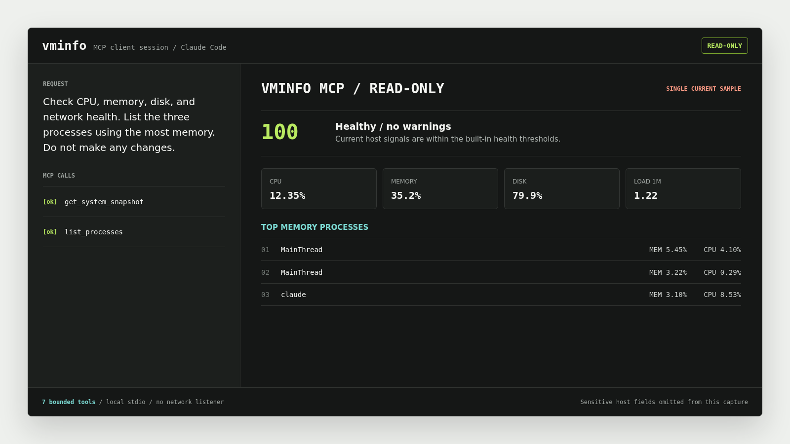

# `vminfo mcp`

Connect an MCP client to current host metrics and bounded network diagnostics
without installing a daemon, database, or separate MCP package. The server is
part of the normal vminfo release binary.



The command starts a tools-only Model Context Protocol server over stdin/stdout:

```bash
vminfo mcp
```

It is intended to be launched by an MCP client. It does not listen on a network
port, start the web dashboard, or perform background update checks. It exits
when the client disconnects.

The binary inspects the machine where it runs. To inspect another server, install
vminfo on that server and configure an MCP client that can launch the binary
there; `vminfo mcp` does not create a remote management endpoint.

## Install

Linux and macOS:

```bash
curl -fsSL https://raw.githubusercontent.com/cloudapp3/vminfo/main/install.sh | sudo bash -s -- --dir /usr/local/bin
```

Windows, package, archive, and Go installation options are covered in the
[installation guide](/guide/installation).

## Client configuration

Claude Desktop:

```json
{
  "mcpServers": {
    "vminfo": {
      "command": "/usr/local/bin/vminfo",
      "args": ["mcp"]
    }
  }
}
```

Codex:

```toml
[mcp_servers.vminfo]
command = "/usr/local/bin/vminfo"
args = ["mcp"]
```

Use the actual absolute binary path when the client does not inherit your shell
`PATH`. Restart the client after changing its MCP configuration.

## Example requests

Use requests that state both the diagnostic goal and the no-change boundary:

```text
Check this host's CPU, memory, disk, and network health. List the five processes
using the most memory. Do not make any changes.
```

```text
Resolve example.com, test TCP port 443, and report latency or connection errors.
```

```text
Summarize the current host snapshot and explain only the warnings supported by
the returned metrics. Do not infer historical trends from this single sample.
```

## Tools

| Tool | Purpose | Limits |
| --- | --- | --- |
| `get_system_snapshot` | Current system, CPU, memory, disk, network, load, process-count, and health data | Read-only, one current sample |
| `list_processes` | Filter and sort local Linux processes | Default 20, maximum 200; command line hidden by default |
| `resolve_dns` | Resolve a domain | Five-second call timeout |
| `check_port` | Test TCP connectivity and latency | Port 1-65535; timeout at most 10 seconds |
| `ping_host` | Run TCP or ICMP probes | At most 10 probes and 3 seconds per probe |
| `lookup_ip` | Query public IP, ASN, geo, and risk data | Fixed service: `ip.bestcheapvps.org` |
| `get_version` | Read version and build metadata | No arguments |

`list_processes` returns an unsupported tool error on macOS and Windows. ICMP
ping may require operating-system privileges; TCP ping is the portable default.

## Security and privacy

- The server does not expose process termination, self-update, shell commands, file writes, prompts, or resources.
- Process command lines are omitted unless `include_command` is explicitly set to `true`; command arguments may contain credentials. The process filter does not search hidden command lines.
- Snapshot and process data is sent to the model configured by the MCP client.
- DNS, port, and ping tools contact the requested target.
- `lookup_ip` sends an explicit outbound request to `ip.bestcheapvps.org`; callers cannot replace that service URL.

Only configure the server in an MCP client and model environment that you trust.

## Troubleshooting

- Run `vminfo version` with the same absolute path used in the client configuration.
- Run `vminfo mcp --help` in a terminal to confirm the installed release includes MCP support.
- Do not run `vminfo mcp` through a shell wrapper that writes banners or logs to stdout; stdout is reserved for protocol messages.
- Inspect the MCP client's logs when the process starts and immediately exits. A missing executable path is the most common setup error.
