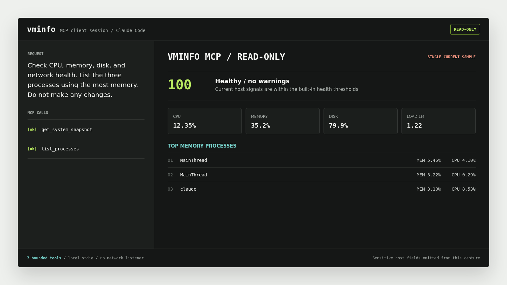

# `vminfo mcp`

无需额外安装守护进程、数据库或独立 MCP 软件包，即可让 MCP 客户端读取当前主机指标并执行有边界的网络诊断。MCP 服务器已经包含在常规 vminfo 发布二进制中。



该命令通过标准输入输出启动只提供 Tools 的 Model Context Protocol 服务器：

```bash
vminfo mcp
```

该命令应由 MCP 客户端启动。它不会监听网络端口、启动 Web 仪表盘或执行后台更新检查，并会在客户端断开后退出。

该二进制检查的是它实际运行所在的机器。若要检查另一台服务器，需要在目标服务器安装 vminfo，并由能够在该服务器启动进程的 MCP 客户端运行它；`vminfo mcp` 本身不会创建远程管理入口。

## 安装

Linux 和 macOS：

```bash
curl -fsSL https://raw.githubusercontent.com/cloudapp3/vminfo/main/install.sh | sudo bash -s -- --dir /usr/local/bin
```

Windows、软件包、压缩包和 Go 安装方式参见[安装说明](/zh/installation)。

## 客户端配置

Claude Desktop：

```json
{
  "mcpServers": {
    "vminfo": {
      "command": "/usr/local/bin/vminfo",
      "args": ["mcp"]
    }
  }
}
```

Codex：

```toml
[mcp_servers.vminfo]
command = "/usr/local/bin/vminfo"
args = ["mcp"]
```

如果 MCP 客户端不会继承 Shell 的 `PATH`，请填写二进制的真实绝对路径。修改配置后需要重启客户端。

## 示例请求

建议同时说明诊断目标和禁止修改的边界：

```text
检查这台主机当前的 CPU、内存、磁盘和网络健康状态，并列出内存占用最高的 5 个进程。不要执行任何修改。
```

```text
解析 example.com，测试 TCP 443 端口，并报告延迟或连接错误。
```

```text
总结当前主机快照，只解释返回指标能够支持的告警。不要从单次采样推断历史趋势。
```

## 工具

| 工具 | 用途 | 限制 |
| --- | --- | --- |
| `get_system_snapshot` | 当前系统、CPU、内存、磁盘、网络、负载、进程数量及健康状态 | 只读，采集一次当前快照 |
| `list_processes` | 过滤和排序本机 Linux 进程 | 默认 20 条，最多 200 条；默认隐藏命令行 |
| `resolve_dns` | 解析域名 | 单次调用最多 5 秒 |
| `check_port` | 测试 TCP 连通性与延迟 | 端口 1-65535；超时最多 10 秒 |
| `ping_host` | 执行 TCP 或 ICMP 探测 | 最多 10 次，每次最多 3 秒 |
| `lookup_ip` | 查询公网 IP、ASN、地理位置及风险数据 | 固定使用 `ip.bestcheapvps.org` |
| `get_version` | 读取版本和构建信息 | 无参数 |

`list_processes` 在 macOS 和 Windows 上返回 unsupported tool error。ICMP ping 可能需要操作系统权限，默认 TCP ping 可跨平台使用。

## 安全与隐私

- MCP 服务器不开放终止进程、自更新、Shell、文件写入、Prompts 或 Resources。
- 只有显式设置 `include_command: true` 才会返回进程命令行；命令参数中可能包含凭据。过滤器不会检索被隐藏的命令行。
- 快照和进程数据会发送给 MCP 客户端所配置的模型。
- DNS、端口和 ping 工具会访问调用方指定的目标。
- `lookup_ip` 会向 `ip.bestcheapvps.org` 发起明确的外部请求，调用方不能替换该服务地址。

请只在可信的 MCP 客户端和模型环境中配置该服务器。

## 故障排查

- 使用客户端配置中的同一个绝对路径运行 `vminfo version`。
- 在终端运行 `vminfo mcp --help`，确认安装版本已经包含 MCP 支持。
- 不要通过会向 stdout 输出欢迎信息或日志的 Shell 包装脚本运行 `vminfo mcp`，stdout 仅用于协议消息。
- 如果进程启动后立即退出，请检查 MCP 客户端日志；最常见原因是二进制路径不存在。
